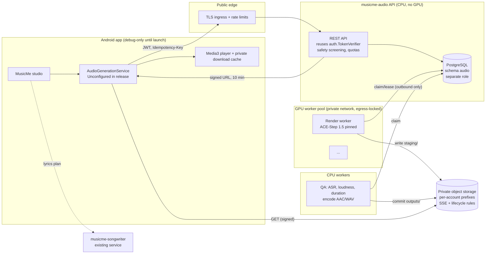

# MusicMe Phase 2.3A — Music and vocal generation architecture (21 Oct 2026)

> **Status: design only.** No audio model has been downloaded, run or listened to. No GPU has been provisioned,
> no paid API used, nothing deployed or installed. Every quality, speed and cost figure below is either a
> **vendor claim** (V), a **third-party report** (T), or **our estimate** (E) unless marked **verified** (✔), which
> here means "read directly from the project's own licence file, repository or model card on 21 Oct 2026" — not
> "tested by us". Legal questions are flagged, not answered; this document is not legal advice.

Continues from commit `2c5ee87` (Phase 2.2C). Production BeatIQ, the Phase 1.5 safeguards and the songwriting
service are unchanged; production AI remains disabled by default.

---

## 1. Model comparison and licence findings

### 1.1 Licences (the gate that decides everything else)

| Model | Code licence | Weight licence | Commercial use of the model | Status for MusicMe |
|---|---|---|---|---|
| **ACE-Step 1.5** (ACE Studio + StepFun, Jan 2026) | MIT ✔ (`pyproject.toml`, README) | MIT ✔ (HF cards `Ace-Step1.5`, `acestep-v15-xl-sft`) | Permitted by licence ✔; card says outputs may be used commercially (V) | **Recommended evaluation candidate** (not approved for production) |
| **HeartMuLa-oss-3B** (heartlib) | Apache 2.0 ✔ | Apache 2.0 ✔ (changed "repo and all related model weights" on 20 Jan 2026) | Permitted by licence ✔ | **Fallback evaluation candidate** |
| **DiffRhythm 2** (ASLP-lab) | Apache 2.0 ✔ | Apache 2.0 ✔ ("code and weights") | Permitted by licence ✔ | Second fallback |
| DiffRhythm v1 | Apache 2.0 ✔ | DiT weights Apache 2.0 ✔; VAE weights not stated | VAE licence unclear | Superseded by v2 |
| YuE v1 (HKUST / M-A-P) | Apache 2.0 ✔ | Apache 2.0 ✔ (since 30 Jan 2025) | Permitted ✔ | Rejected: impractical speed/memory (below) |
| YuE2 | Apache 2.0 ✔ | **CC BY-NC 4.0 + creator permission** ✔ | **Companies must obtain a commercial licence** ✔ | Rejected (needs negotiated licence) |
| LeVo / SongGeneration (Tencent) | Custom ✔ | "academic, research and education purposes" only; "refrain from using it for any commercial or production purposes" ✔ | **No** | Rejected |
| SongBloom (Tencent / CUHK) | Unverifiable | Unverifiable — upstream repos deleted; mirrors claim Apache 2.0, others say non-commercial (T) | Unknown | Rejected (no provenance) |
| MusicGen (Meta) | MIT | CC BY-NC 4.0 (prior knowledge, not re-checked this session) | No | Rejected (also no vocals) |
| Stable Audio Open 1.0 | — | Stability AI Community Licence (prior knowledge, not re-checked) | Revenue-capped | Rejected (no vocals, ~47 s) |

**What the licence findings do and do not establish.** A ✔ licence means the model and code may legally be used
and modified commercially under that licence's terms (MIT/Apache notices retained). It does **not** establish that
the training data was lawfully licensed, that outputs are free of third-party rights, or that outputs are
copyrightable — those are vendor claims (V) or unresolved legal questions (§5, §8 R1–R4) for every candidate,
including the recommended one.

**ACE-Step 1.5 dependency licences** (from `pyproject.toml`; licences from general knowledge, to be confirmed by
a licence scanner in Phase 2.3C): PyTorch/torchaudio/torchao (BSD), transformers, diffusers, accelerate, peft,
lightning (Apache 2.0), MLX/mlx-lm (MIT), FastAPI/uvicorn (MIT/BSD), numba/scipy (BSD), soundfile (BSD),
vector-quantize-pytorch, pytorch-wavelets (MIT), nano-vllm (MIT, unverified), modelscope (Apache 2.0),
gradio (Apache 2.0, **not deployed** — we would call the Python pipeline, not the UI). The bundled LMs are
fine-tuned from Qwen3 (Apache 2.0). No copyleft dependency was seen, but **ffmpeg** (used for encoding, §3.6) is
LGPL/GPL depending on build flags and must be built LGPL-only.

### 1.2 Capabilities

| | ACE-Step 1.5 | HeartMuLa-oss-3B | DiffRhythm 2 | YuE v1 |
|---|---|---|---|---|
| Vocals + instrumental in one pass | Yes ✔ (lyrics-driven song generation) | Yes (lyrics + tags) ✔ | Yes ✔ | Yes ✔ |
| Instrumental-only / accompaniment | Vocal2BGM, stems, "Add layer" ✔ | Not documented | Not documented | Not documented |
| Lyric conditioning | Yes ✔; lyric-alignment score 26.3 (V, authors' own metric) | Yes ✔; 28.6, best in same table (V) | Yes; 3.8 in same table (V) | Yes; −4.6 (V) |
| Languages | "50+ languages" (V), no list; paper trained mostly Chinese/English evaluation | "almost all languages" (V) | Not stated | EN, zh, yue, ja, ko ✔ |
| Max duration | 10 s – 600 s ✔ | default 240 s ✔ | "full-length" (v1: 4 m 45 s ✔) | sessions of ~30 s; 4+ sessions need ≥ 80 GB ✔ |
| Whole song vs sections | **Whole song in one pass** ✔ | Whole song ✔ | Whole song ✔ | Section sessions (verse/chorus) ✔ |
| GPU memory | < 4 GB minimum; 2B turbo + 1.7B LM on 12–16 GB; XL 4B + 4B LM ≥ 24 GB (V: vendor tier table, untested) | Not stated (FAQ suggests 2 GPUs or lazy load) | Not stated (v1 base ≥ 8 GB) | 24 GB for ≤ 2 sessions; ≥ 80 GB for full songs ✔ |
| Speed | 240 s track in "∼1 s" on A100 (8-step turbo); "< 10 s" per song on RTX 3090 (V); two 100 s songs ≈ 58 s on M1 Max 64 GB (T) | Real-time factor ≈ 1.0 ✔ → ~2.5 min per 2:30 song (E) | Not stated | 30 s audio = 360 s on RTX 4090 ✔ → ~30 min per song (E) |
| Controllability | BPM, key/scale, time signature, duration, captions, repaint (regenerate a region), cover, LRC output, quality scoring ✔ | Tags; reference audio is TODO ✔ | Lyrics + style prompt | Genre tags, in-context reference |
| Voice cloning risk | **Zero-shot timbre cloning from reference audio** (paper, V); LoRA from 8 songs ✔ | Not yet | Not documented | In-context reference audio |
| Apple Silicon | MPS + MLX ✔ | Not documented | Not documented | No |
| Training data disclosure | "licensed music, royalty-free/public domain, and synthetic (MIDI-to-audio)" (V); corpus 27 M samples (paper) | **None** | "Coming soon" | Not described |
| Quality (third-party) | Highest style alignment and AudioBox scores in its own paper (V) | Strong lyric control (V) | Listening test: "more artificial" (T) | Listening test: unremarkable (T) |

**Not verified by anyone neutral:** no independent head-to-head benchmark covers all candidates with current
licences. All quality comparisons above are self-reported or single-reviewer blog tests.

## 2. Recommendation (evaluation candidates, not production approval)

> No model is approved for production. Approval requires the 2.3B listening gate, the 2.3D measured
> performance/cost gate and written legal sign-off in 2.3F (§7). Until then the choices below are what to
> evaluate first.

**Primary evaluation candidate: ACE-Step 1.5**, `acestep-v15-turbo` or `-sft` (2B DiT) with the 1.7B planning
LM, on a 24 GB GPU.
Reasons: MIT weights and code (the clearest licence in the field), a stated licensed/royalty-free training
corpus (still a vendor claim — §4), whole-song generation up to 10 minutes, duration/BPM/key controls, region
repaint for repairs, stems, LRC output, and runs on Apple Silicon for development. XL (4B) is a later quality
upgrade if 2.3D listening shows a clear gain worth the larger GPU.

**Fallback evaluation candidate: HeartMuLa-oss-3B** (Apache 2.0). Best published lyric control, but real-time-factor speed (~1×),
unstated memory needs and **no training-data disclosure** (a provenance risk that would need legal sign-off).
**Second fallback: DiffRhythm 2** (Apache 2.0) if both fail quality or provenance review.

**Mandatory restrictions on the chosen model** (all enforced server-side):
- Reference-audio, timbre-cloning, cover and LoRA-training features are **disabled** in the service build; the
  API has no audio-upload field. A future "house voice" LoRA may only use recordings from a contracted,
  consenting, paid singer (Phase 2.3F+, needs legal approval).
- Captions are built by the server from structured fields (genre, mood, tempo, instrumentation, vocal type such as
  "warm female alto"); free text is screened by the existing `safety.py` rules, which already block "voice of" /
  "clone" / named-artist requests, extended to block "in the style of <artist>" and song titles.
- Weights pinned by revision and SHA-256, downloaded once by an operator, mirrored to private storage; workers
  never reach Hugging Face at runtime (as Phase 2.2B did for Qwen3).

## 3. Song assembly

### 3.1 Whole-song generation (no stitching by default)
One ACE-Step pass generates the full song from structured lyrics, so voice, key, tempo and mix stay consistent
— avoiding the drift and seams of section-by-section stitching. Target length **~150 s** is passed as the
`duration` parameter; the delivered length is **measured, not promised**: acceptance band 135–170 s (E, to be
validated in 2.3B). If the model ignores the band repeatedly, the bridge/outro is shortened in the lyric plan, not
cut from audio.

### 3.2 Structure → model input
The songwriting plan (sections with ids, labels and lyrics, possibly edited by the user) is converted to
section-tagged lyrics: `[Intro]`, `[Verse 1]`, `[Pre-Chorus]`, `[Chorus]`, `[Bridge]`, `[Outro]`. Intros/outros with
no lyrics become instrumental sections (`[Intro]` with no lines, or `[Instrumental]`). **The exact tag vocabulary
ACE-Step 1.5 honours is not documented in the paper and must be verified in 2.3B.** Lines labelled `Lead:` /
`All:` are converted to plain lines (call-and-response is a 2.3B test case).

### 3.3 Style, tempo and arrangement
The planning LM can choose BPM, key and structure; MusicMe instead **pins** BPM (from genre defaults or the user's
tempo choice), key (optional) and time signature, and lets the LM only plan the arrangement. The seed is stored so a
song can be re-rendered identically (determinism across GPU types is unverified).

### 3.4 Vocal identity
Within a song: a single pass keeps one voice (to be checked by listeners in 2.3B, with duets as an explicit test).
Across songs: there is **no persistent voice identity** in v1 — a deliberate safety choice. Users choose a vocal
description, not a person.

### 3.5 Lyric-to-audio timing
ACE-Step can emit LRC timestamps (V). We will measure intelligibility with a separate ASR (Whisper-class, MIT,
self-hosted) and report word error rate per section. **No karaoke-accurate sync is promised**; on-screen lyrics
will be shown per section until timing accuracy is measured. Skipped, repeated or garbled lines are expected
failure modes for every current model.

### 3.6 Post-processing and formats
Master: 48 kHz stereo WAV (VAE operates at 48 kHz stereo ✔). CPU post-processing (no GPU):
loudness normalisation to −14 LUFS integrated, true peak ≤ −1 dBTP (pyloudnorm-style), 1 s fade-in on
instrumental starts and 3 s fade-out if the model ends abruptly, silence trim. Delivery:
- **AAC-LC 256 kbps in `.m4a`** for streaming and download (≈ 4.8 MB for 150 s, E);
- **WAV** kept only 7 days for optional download (≈ 28.8 MB);
- embedded metadata: title, "Created with MusicMe (AI-generated audio)", model + prompt version, job id.
Encoding with an LGPL-only ffmpeg build (no `--enable-gpl`/`nonfree`). An inaudible watermark (e.g. AudioSeal) is
a candidate; its licence and robustness are unverified.

### 3.7 Quality checks and partial failures
Each take passes automated QA before anyone hears it: duration band, non-silent sections, no clipping, loudness
range, ASR word error rate per lyric section below a threshold (calibrated in 2.3B), language id of the vocals.
- Whole take fails → one re-render with a new seed (counts against the GPU budget).
- One section fails ASR → **repaint** that time region only (ACE-Step feature, V), then re-check.
- Still failing → job fails with `AUDIO_QUALITY` and a friendly message; **partial audio is never shown or
  stored**; the lyrics stay safe on the device and the user's quota is refunded.
- Worker crash mid-render → the lease expires, the job is re-queued (same mechanism as songwriting).

## 4. Architecture

### 4.1 Service boundaries
- **New service `services/musicme-audio`**, separate process, container image, database schema, DB role, bucket
  and secrets from `musicme-songwriter`. A compromise of one does not expose the other's data.
- **Reused by copy-and-adapt, not shared runtime**: `auth.py` (HS256 / RS256 / ES256 JWKS verification, account
  hashing), the `jobs` state machine and lease logic from `store.py`, the `db.py` dialect layer, migrations runner,
  `safety.py` rules, error envelope and contract versioning. A shared library package can come later once both
  services are stable.
- **The audio service never calls the songwriting service.** The app submits the final (possibly user-edited)
  lyric plan; the audio service re-validates it with the same contract rules and safety screening. Locked/user
  lyrics are rendered exactly as written — never rewritten.
- **Production isolation**: nothing is deployed in Phase 2.3. The app's `MUSICME_AUDIO_URL` is empty by default and
  release builds use `UnconfiguredAudioGenerationService` (§4.9); the production BeatIQ backend, its data and the
  Phase 1.5 safeguards are not touched. The audio service gets its own environments (local → staging) and is
  reachable only by debug builds until a launch decision.

### 4.2 API (contract `musicme.audio.v1`)
| Method | Path | Notes |
|---|---|---|
| GET | `/v1/capabilities` | enabled, model id/revision, max duration, languages, quotas remaining |
| POST | `/v1/audio-jobs` | JWT + `Idempotency-Key`; body: lyric plan, genre, mood, tempo, vocal description, language, duration target, `takes` (1–2) |
| GET | `/v1/audio-jobs/{id}` | state, stage, progress, queue position, error, result (track ids) — account-scoped (404 for other accounts) |
| POST | `/v1/audio-jobs/{id}/cancel` | idempotent |
| GET | `/v1/tracks/{id}/download?format=m4a\|wav` | returns a short-lived signed URL after an ownership check |
| DELETE | `/v1/tracks/{id}` and `/v1/account/audio` | user deletion / account deletion |

### 4.3 Jobs, queue and recovery
States: `queued → rendering → post_processing → succeeded | failed | cancelled` (stages within `running`).
- PostgreSQL `FOR UPDATE SKIP LOCKED` claims with leases, heartbeats every 15 s during render, expiry requeue,
  `max_attempts` = 2 for GPU work (renders are expensive), `WORKER_LOST` / `GPU_OOM` / `AUDIO_QUALITY` codes.
- Idempotency: unique `(account, idempotency_key)` + body hash; same key, different body → 409 (as songwriting).
- Per-account limits: 1 active audio job, daily song quota (e.g. 3 free), monthly GPU-seconds cap; global queue
  cap with 503 + `Retry-After` when full; job TTL in queue (e.g. 30 min).
- Lyric plan (`spec_json`) purged at terminal state; results keep only track ids and metadata.

### 4.4 Cancellation
`cancel_requested` set by the API. Workers check it before render, between render and post-processing, and before
commit; ACE-Step turbo renders are short (V: seconds), so a mid-render interrupt is not needed — a cancelled job's
render output is discarded and its staging objects deleted. Commit is lease-owner- and cancel-guarded in one
transaction (same pattern as `store.complete`). Quota is refunded for cancelled and failed jobs.

### 4.5 Storage
- Private S3-compatible bucket (MinIO locally; R2 / S3 / GCS in hosted environments), **no public ACLs**,
  server-side encryption, object keys `acct/<account_hash>/<track_id>/<format>` (no names or titles in keys).
- Workers write to `staging/` and the post-processor moves to `outputs/` only on commit; a lifecycle rule deletes
  `staging/` after 24 h (backstop for crashes).
- Downloads use signed GET URLs valid 10 minutes, issued only after the API checks ownership. No listing
  permission for clients.

### 4.6 Retention and cleanup (proposed defaults, to be approved)
| Data | Retention |
|---|---|
| Lyric plan in job row | Deleted at terminal state |
| Non-selected takes | 24 h |
| WAV master | 7 days |
| AAC track | 30 days server-side (the app keeps its own downloaded copy) |
| Job metadata (no lyrics) | 30 days, then deleted |
| Account deletion | All objects + rows deleted within 24 h, verified by a sweep |
| Logs | No lyrics, prompts or audio; job id, account hash, timings, error codes only |

### 4.7 GPU worker isolation
Workers run in a private subnet with **no inbound ports**; outbound only to the database and storage endpoints
(egress allow-list), no internet at runtime. A non-root container with a read-only root filesystem and weights
mounted read-only (SHA-256 checked at start). Scoped credentials: the DB role may only claim/update `audio.jobs`;
the storage credential may only write `staging/`. One render per GPU at a time (no OOM contention). The API tier
never loads models.

### 4.8 Progress reporting
`stage` + `progress` (0–100) + `queue_position`. Rendering progress is coarse (planning, rendering, decoding)
because turbo renders are short; most user-visible waiting is queue + QA. The app polls with backoff
(2 s → 10 s), as the songwriting client does. Push notifications are a later option.

### 4.9 Android integration (Phase 2.3E, not now)
`AudioGenerationService` interface mirroring `SongwritingService`: `RemoteAudioGenerationService` (debug only)
and `UnconfiguredAudioGenerationService` in release builds until launch, configured by an empty-by-default
`MUSICME_AUDIO_URL`. Playback with Media3/ExoPlayer from the signed URL or downloaded file; downloads go to
app-private storage, with user-initiated export to MediaStore. Room stores track ids, durations and local paths,
never signed URLs. Phase 1.5 backup/data-safety rules extended to cover audio files.

### 4.10 Cost controls
Daily per-account quota; max duration 240 s; max 2 takes; turbo model by default; one automatic retry only; GPU
pool scales to zero when the queue is empty (cold-start cost accepted); global monthly GPU budget with a kill
switch that flips `/v1/capabilities` to disabled; WAV deleted after 7 days; storage alerts.

## 5. Safety and rights

| Topic | Position | Unresolved |
|---|---|---|
| Model licence | MIT (ACE-Step 1.5) ✔ permits commercial use and modification with notice | Licence covers the model, not the training data or outputs |
| Training-data provenance | Vendor states licensed + royalty-free + synthetic data (V) | **Unverified.** The 27 M-sample corpus size makes the claim worth documenting; request a data statement from ACE Studio / StepFun; legal review required before launch |
| Output similarity | No reference audio; captions without artist names; lyric screening already in place | No melody/audio similarity check against commercial catalogues exists in-house; fingerprint services (e.g. AcoustID) have their own commercial terms. Accepting residual risk needs legal sign-off |
| Voice imitation | Reference audio/cloning/LoRA disabled; artist-voice requests blocked; vocal descriptions only | Model may still produce a voice resembling a real singer by chance; takedown process needed. Voice-likeness laws (e.g. Tennessee ELVIS Act, right-of-publicity laws) vary by jurisdiction |
| Ownership and permitted use | User's own lyrics remain theirs | **Copyrightability of AI-generated audio is unsettled** (e.g. US Copyright Office's 2025 position that purely AI-generated material is not protectable; UK computer-generated-works rule; Nigerian position unknown). Terms of service must not promise exclusive copyright; legal to draft |
| Labelling | Metadata and in-app "AI-generated" label | EU AI Act transparency duties for synthetic audio and other disclosure rules — applicability and dates to confirm with counsel |
| Model provenance | Pinned revision + SHA-256, private mirror, SBOM | ACE-Step weights are not signed by the vendor |
| Privacy | Lyrics purged at terminal state; no lyrics in logs; per-account prefixes; deletion endpoints | Audio of personal dedications is personal data in some jurisdictions; DPIA recommended |
| Abuse | Quotas, safety screening (hate, sexual content involving minors, harassment, real-person impersonation), no audio upload, takedown/report flow | Moderation of generated audio content (e.g. vocals singing words not in the lyrics) is limited to ASR checks |
| Third-party code | Permissive dependencies; LGPL ffmpeg | Licence scan + NOTICE file required in 2.3C |

## 6. Feasibility and cost (all estimates unless marked)

### 6.1 Local Mac (development only)
This M1 / 8 GB Mac: ACE-Step 2B turbo with no LM or the 0.6B LM, INT8 / offload; cannot run concurrently with the
Qwen3-4B songwriting server. One third-party report: two 100 s songs in ≈ 58 s on an **M1 Max 64 GB** (T). On
8 GB, expect **1–5 minutes per song with memory pressure (E)** — enough for functional and listening tests,
not for performance claims. Download ≈ 5–10 GB (E) requires approval.

### 6.2 Hosted GPU options (prices are third-party snapshots, Sept–Oct 2026, **verify before any spend**)
| GPU | VRAM | Fits (vendor VRAM tiers, untested) | ~$/hour (T) | Notes |
|---|---|---|---|---|
| NVIDIA L4 | 24 GB | 2B + 1.7B LM; XL with offload | 0.33–0.49 | Efficient, slower than 4090 |
| RTX 4090 | 24 GB | 2B + 1.7B / 4B LM; XL turbo | 0.14–0.34 community, ~0.69–0.74 secure | Community hosts unsuitable for personal data |
| L40S | 48 GB | XL + 4B LM, headroom | 0.79–1.09 | Quality upgrade path |
| A100 80 GB | 80 GB | Everything | 1.19–2.79 | Overkill for ACE-Step |

### 6.3 Per-song estimate (E) — ACE-Step 1.5 2B turbo + 1.7B LM on L4, 150 s song

Every figure in this table is an **estimate until measured in Phase 2.3D**.
| Step | Estimate |
|---|---|
| LM planning + DiT render + VAE decode | 15–60 s (vendor: < 10 s on 3090; we assume 2–6× slower in practice on L4) |
| ASR QA + encode (CPU or same GPU) | 10–20 s |
| Takes per delivered song (incl. retries) | 1.5 average |
| GPU-seconds per delivered song | **~40–120 s** |
| Compute at $0.49/h, 100% utilisation | **~$0.006–0.016** |
| At 25% utilisation (idle time paid) | **~$0.02–0.07** |
| Always-on single L4 | ~$360 / month regardless of volume |
| Throughput per GPU | ~30–90 songs / hour; **concurrency 1 render per GPU** |

### 6.4 Storage and bandwidth (E)
AAC 150 s ≈ 4.8 MB; WAV ≈ 28.8 MB for 7 days. 10,000 songs/month ≈ 48 GB AAC + ~70 GB rolling WAV → ~$2–3 /
month storage at ~$0.015–0.023 / GB-month. Egress: ~5 MB per download; free on zero-egress providers, ~$0.0005
per download at ~$0.09 / GB. Storage is negligible next to GPU idle cost.

### 6.5 Operational risks
Cold starts when scaling from zero (loading ~5–10 GB weights: 30–120 s, E); GPU host availability and price
changes; PyTorch/CUDA version pinning (the project pins `torch==2.10.0+cu128` on Linux); model updates changing
output for the same seed; noisy-neighbour risk on community GPU marketplaces (excluded for personal data); vendor
speed claims not reproduced.

## 7. Implementation phases and acceptance gates

| Phase | Scope | Needs approval | Acceptance gate |
|---|---|---|---|
| **2.3A** (this) | Research and design | — | This document reviewed |
| **2.3B** Local spike | Download ACE-Step 1.5 2B turbo + 0.6B/1.7B LM (pinned), CLI-only runs on the Mac, 16 MusicMe scenarios × 2 seeds, tag-vocabulary tests, duration/ASR measurements, blinded listening with ≥ 2 reviewers | Model download (~5–10 GB) | Runs end-to-end on Mac; ≥ 80% of songs in 135–170 s; median section WER ≤ 25% (E, calibrate); no stage-direction or artist-like output flagged; ≥ 2 reviewers' median "usable song" ≥ 3/5 |
| **2.3C** Service skeleton | `musicme-audio` with a mock engine producing synthetic tones: auth, jobs, leases, cancel, idempotency, quotas, MinIO storage, signed URLs, retention sweeps, deletion, licence scan; no GPU | None (local only) | Test suite incl. account isolation, crash recovery, cancellation, idempotency, retention; licence scan clean; no lyrics in logs |
| **2.3D** GPU evaluation | One rented GPU (L4) for a bounded test run; real latency, memory, cost per song, cold start; XL vs 2B listening comparison | **Paid GPU (budget cap)** | p90 job time ≤ 3 min; cost per delivered song ≤ $0.10 at assumed utilisation; zero OOM in 200 renders |
| **2.3E** Android integration | Debug-only client, Media3 playback, downloads, Room records, Phase 1.5 data rules | Device install for testing | Instrumented + unit tests; release build still Unconfigured |
| **2.3F** Rights and pilot readiness | Legal review (data provenance, ToS, ownership, labelling, voice likeness), DPIA, takedown flow, human panel | Legal counsel | Written legal sign-off; panel approval; then a limited pilot decision |

## 8. Risk register

| # | Risk | Likelihood | Impact | Mitigation | Owner / status |
|---|---|---|---|---|---|
| R1 | Training data not as licensed as claimed | Medium | High | Vendor data statement, legal review, fallback model | Open — legal |
| R2 | Output resembles an existing song or artist voice | Medium | High | No reference audio, no artist captions, takedown flow, similarity research | Open — legal/product |
| R3 | AI audio not copyrightable; users expect ownership | High | Medium | Honest ToS; lyrics ownership separate | Open — legal |
| R4 | Labelling/transparency laws | Medium | Medium | Metadata + UI label, watermark evaluation | Open — legal |
| R5 | Vocal quality or intelligibility too low (esp. non-English) | High | High | 2.3B listening gate; English-first; other languages disabled until native review | Open — 2.3B |
| R6 | Duration/lyric sync misses | High | Medium | Measured bands, repaint, section-level lyrics UI | Open — 2.3B |
| R7 | Vendor speed claims not reproduced; cost higher | Medium | Medium | 2.3D measurement, quotas, turbo default | Open — 2.3D |
| R8 | GPU worker compromise / data exfiltration | Low | High | No inbound, egress allow-list, scoped creds, read-only FS | Design |
| R9 | Signed URL leakage | Low | Medium | 10-min expiry, ownership check, no listing | Design |
| R10 | Cost overrun from abuse | Medium | Medium | Quotas, global budget kill switch, scale-to-zero | Design |
| R11 | Model/dependency supply chain | Low | High | Pinned revisions, SHA-256, private mirror, SBOM, licence scan | Design |
| R12 | Personal dedications retained too long | Low | Medium | Retention table, deletion sweeps, no lyrics in logs | Design |
| R13 | Copyleft contamination (ffmpeg GPL) | Low | Medium | LGPL-only build, scan | Design |
| R14 | Mac too small for realistic tests | High | Low | Treat Mac as functional only; real numbers from 2.3D | Accepted |
| R15 | Carried over: HS256 shared secret, no encryption at rest in songwriting DB, non-interruptible model calls, no per-IP throttling | — | — | Prefer RS256/JWKS for audio; storage SSE | Open (from 2.2) |

## 9. Feasibility assessment

| Criterion | Result |
|---|---|
| A commercially licensed open-weight model with vocals exists | **PASS** — ACE-Step 1.5 (MIT ✔), HeartMuLa (Apache 2.0 ✔), DiffRhythm 2 (Apache 2.0 ✔) |
| Whole ~2:30 songs with structure in one pass | **PASS (vendor-claimed, untested)** |
| Fits affordable self-hosted GPUs (≤ 24 GB) | **PASS (vendor-claimed)** |
| Architecture preserves auth, isolation, durability, cancellation, idempotency, retention | **PASS (design)** — reuses proven 2.2A patterns |
| Estimated cost per song well under $0.10 | **PASS (estimate)** — unmeasured |
| Output quality acceptable to listeners | **NOT ASSESSED** — no audio generated |
| Training-data provenance and output rights cleared | **FAIL (unresolved)** — needs legal review |
| Non-English vocals | **NOT ASSESSED** — remain disabled |

**Overall: CONDITIONAL PASS** to proceed to Phase 2.3B (local spike) and 2.3C (mock-engine service). **Not a pass
for commercial launch**: quality is untested and the legal items in §5/§8 are open. ACE-Step 1.5 is the first model
to evaluate, not an approved production model.

## Sources (read 21 Oct 2026)
- ACE-Step 1.5 repository and `pyproject.toml`: https://github.com/ace-step/ACE-Step-1.5
- ACE-Step 1.5 model cards: https://huggingface.co/ACE-Step/Ace-Step1.5, https://huggingface.co/ACE-Step/acestep-v15-xl-sft
- ACE-Step 1.5 paper: https://arxiv.org/abs/2602.00744
- HeartMuLa: https://github.com/HeartMuLa/heartlib
- YuE / YuE2: https://github.com/multimodal-art-projection/YuE (and branch `YuE-v1`)
- DiffRhythm: https://github.com/ASLP-lab/DiffRhythm; DiffRhythm 2: https://github.com/ASLP-lab/DiffRhythm2
- SongGeneration licence: https://huggingface.co/spaces/tencent/SongGeneration/blob/main/LICENSE
- SongBloom mirror (upstream deleted): https://huggingface.co/rtikw/SongBloom
- M1 Max report (T): https://dev.to/bigkijimon/100-free-fully-local-ai-music-generation-on-an-m1-mac-ace-step-15-two-100-second-vocal-songs-3h1b
- Listening comparison (T): https://www.it-jim.com/blog/best-open-source-ai-music-generator/
- GPU price snapshots (T): https://gpuinsights.net/gpu-cloud-pricing-comparison-2026/, https://www.hostinger.com/tutorials/cloud-gpu-pricing/
